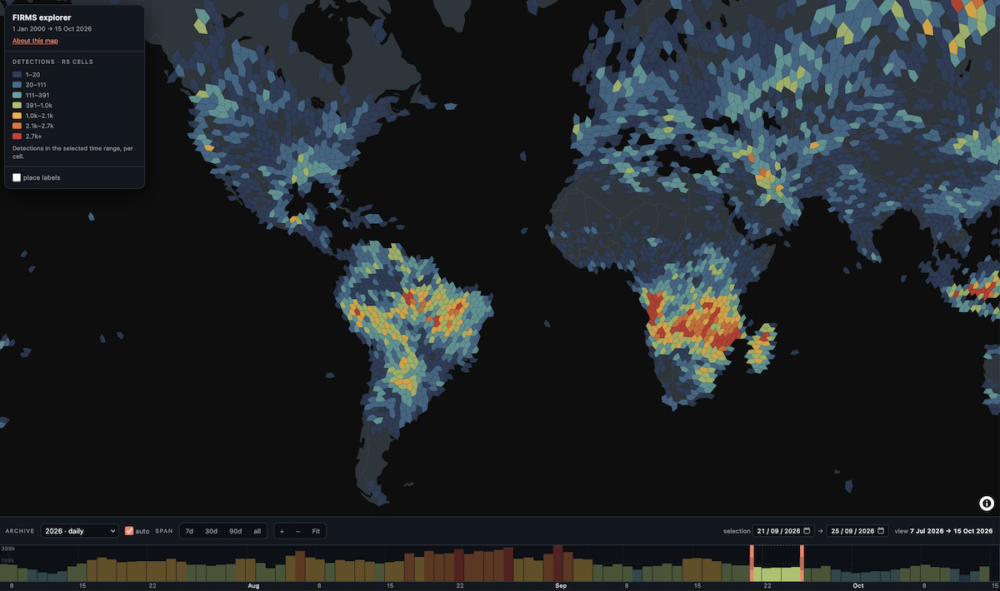
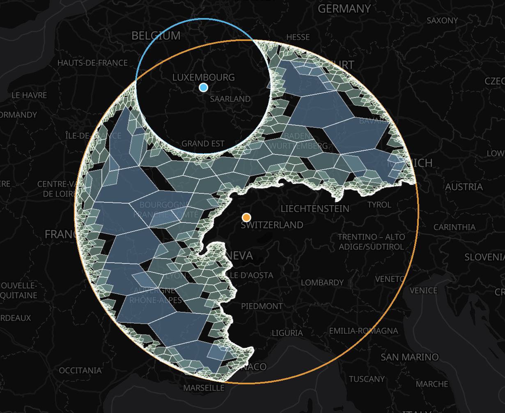

It has been 18 months since the first announcment of A5. What started off as a experiment in visualization (and an obsession with pentagons) has grown into a useful tool, with a wealth of [libraries, tools and software](/docs/ecosystem) building on top.

Today I'm excited to announce that the `v1.0` version of A5 is out, bringing a powerful set of features and performance improvements as well as crystalizing the grid and index definition for the future.

If you're new to A5, in a nutshell it is a grid system that allows the representation of any position, line or polygon region on the globe as a compact 64-bit integer. The industry term for this is a DGGS, and there are already a number of other systems out there which are powering some of the world's largest companies and data analytics pipelines. For a concrete example of an application, take a look at the [FIRMS Explorer](https://portolan-mirrors.github.io/firms-catalog/) which uses A5 to aggregate 631 million fires worldwide since November 2000.

## Powerful data analytics

### Compacted data processing

New in `v1.0` is a whole new set of functions for working with collections of cells, known as [coverings](/docs/api-reference/coverings). 

### Equal area

One of the key strengths of A5 has always been the guarantee that every cell is **exactly** the same area at a given resolution, which means that any analysis run using the system is [free of bias](/docs/recipes/a5-vs-h3) due to unequal cell sizes. Newly in `v1.0`, all the cells at all resolutions have the same pentagonal topology - unlike a common limitation of hexagon-cell systems which must include 12 pentagonal cells, which complicate the topology and break the pure equal-area guarantee.

### Vibrant ecosystem

One of the important characterics of a grid system is its support across a range of tools and software, both in industry and academia. By standardizing on a definiton of the grid and cell identifiers, it is easy to move data between systems and applications. For example, the FIRMS explorer above was builtusing:

- [Geoparquet.io](https://geoparquet.io/) to [aggregate](https://geoparquet.io/concepts/spatial-indices/?h=a5#a5-cells) the data: `gpio add a5 input.parquet output.parquet --resolution 15`
- [Portolan](https://www.portolan-sdi.org/) to host
- a5-js and the [A5Layer](https://deck.gl/docs/api-reference/geo-layers/a5-layer) in deck.gl to visualize

Along with a raft of implementations in popular systems, such as [DuckDB](https://query.farm/products/extensions/a5/), [R](https://belian-earth.github.io/a5R/dev/index.html), [Python](https://github.com/felixpalmer/a5-py) and more, having a common standard for

### Under the hood

Over the past 18 months, the design of A5 has been refined - both from the point of view of
